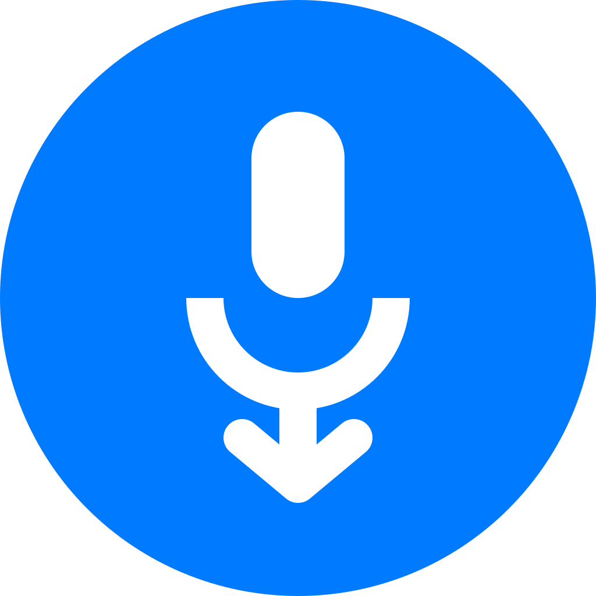
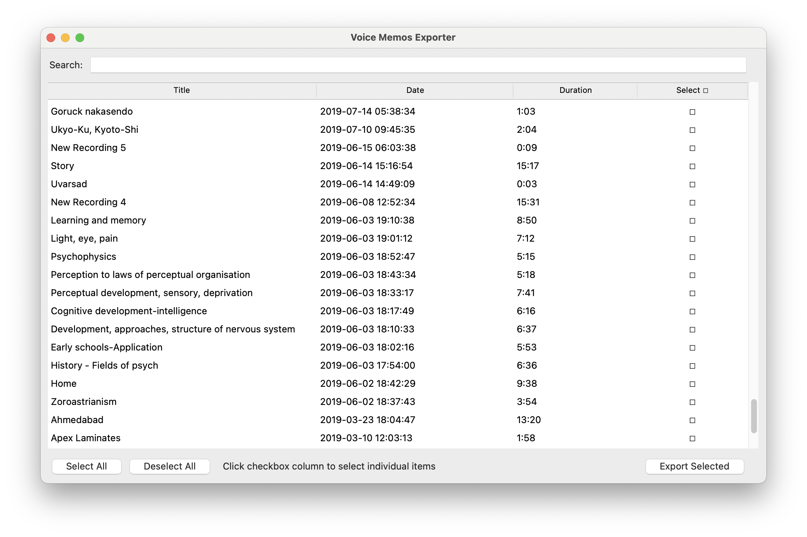

# Voice Memos Exporter

  

**Your recordings, out of Voice Memos and into your own folders.**

A simple Mac app for exporting multiple Apple Voice Memos at once. Browse your recordings, select what you need, and save copies to a folder of your choice.

Useful for backing up interviews, archiving lectures, collecting voice notes, or moving recordings into an editing or transcription workflow.

**[Download for Mac](https://github.com/rudrakabir/voice-memos-exporter/releases/latest)** · **[View releases](https://github.com/rudrakabir/voice-memos-exporter/releases)** · **[Get help](https://github.com/rudrakabir/voice-memos-exporter/issues)**

  

## What you can do

- **Export recordings in batches.** Choose individual memos or select the entire list.
- **Find recordings with search.** Browse titles, dates, and durations in one window.
- **Export synced iPhone recordings.** Once your iPhone memos are available in Voice Memos on your Mac, you can export them here.
- **Keep recognizable filenames.** Exported copies use recording titles, with numbered suffixes when a filename already exists.
- **Work locally.** The exporter works offline and does not upload recordings or collect analytics.

## Get started

1. Open the **[latest release](https://github.com/rudrakabir/voice-memos-exporter/releases/latest)** and download `Voice.Memos.Exporter.zip` under **Assets**.
2. Unzip the download and move **Voice Memos Exporter** into your **Applications** folder.
3. Open the app.
4. Grant **Full Disk Access** when prompted, then restart the app.

Full Disk Access allows the exporter to read the protected Voice Memos library on your Mac.

## Export your recordings

1. Open Voice Memos Exporter.
2. Browse the list to find the recordings you want.
3. Click their checkboxes, or use **Select All**.
4. Click **Export Selected**.
5. Choose a destination folder.

The app shows progress while copying and reports how many recordings were exported, including any that failed.

## Using it with an iPhone

Voice Memos Exporter runs on your **Mac**. To export recordings made on an iPhone, first let them sync through iCloud and confirm they appear in Apple’s Voice Memos app on your Mac.

The exporter reads the local Mac library; it does not connect directly to your iPhone or download recordings from iCloud itself.

## Questions

**Will exporting remove my original recordings?**  
No. The app copies the selected audio files to your destination folder.

**Does it convert the audio?**  
No. It copies the existing files without re-encoding them.

**What happens if two recordings have the same name?**  
The app adds a numbered suffix, such as `Interview_1.m4a`, instead of overwriting an existing file.

**Where can I check compatibility or report a problem?**  
See the [release notes](https://github.com/rudrakabir/voice-memos-exporter/releases) and [existing issues](https://github.com/rudrakabir/voice-memos-exporter/issues). When reporting a problem, include your macOS version, Mac processor, app version, and the error message.

## Contribute

Bug reports, suggestions, and contributions are welcome. See the [contributing guide](docs/CONTRIBUTING.md) to get started.

## Support the project

Made by **[Rudra Kabir](https://github.com/rudrakabir)**.

If this tool saves you time, you can **[buy me a coffee](https://www.buymeacoffee.com/rudrakabir)**.

Released under the **[MIT License](LICENSE)**.
